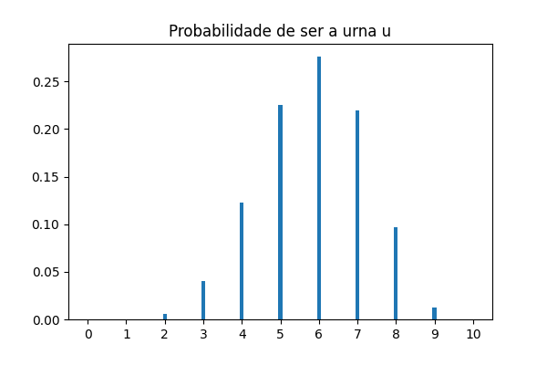
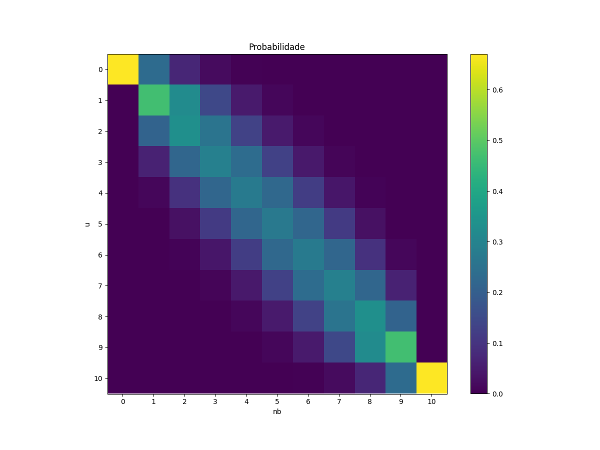

Anotações desordenadas sobre as periferias da aprendizagem estatística.


<!-- Aqui é Body Builder Ipsum PORRA! É verão o ano todo vem cumpadi. Vem porra! É nóis caraio é trapezera buscando caraio! Tá comigo porra. Aqui nóis constrói fibra, não é água com músculo.
 -->


## o hello world do raciocínio probabilístico

<p class="topico">estatística</p>

Do ponto de vista estatístico ambas, regressão e classificação, podem ser pensadas como a busca pela aproximação de uma certa $f(y \| x, w)$ que relaciona o conjunto de propriedades $x$ de uma observação à chance $p$ de certa informação de interesse $y$ dessa observação possuir determinado valor.

Em uma regressão $y$ é uma variável contínua. No problema de classificação $y$ é discreta. Em particular $y \in \\{0, 1\\}$ dá origem a problemas de classificação binária.<br/>
Fundamentalmente essa função $f$ tal que $f(y \| x,w) \mapsto p$ nunca é completamente conhecida então há alguma liberdade na sua escolha. Desde um ponto de vista probabilístico as funções que compõem a chamada _família exponencial_ recebem atenção especial na tarefa de estimar $p$. Duas escolhas clássicas são

$$ \begin{cases}
p \sim \mathcal{N}(y|w^T \phi(x), \sigma^2) \qquad \text{(regressão)} \\
p \sim Bern\left( y | \frac{1}{1+e^{-w^T x}} \right) \quad \text{(classificação)} 
\end{cases} $$

## a regressão logística

<p class="topico">classificação</p>

Nos primórdios nada havia. Então surgiu a regressão linear. Muita gente boa debruçou sobre esse problema, dando origem a métodos como o dos mínimos quadrados. A princípio os métodos de regressão só funcionam quando a variável de interesse $y$ -- ou _"target"_, ou _"variável resposta"_, ou _"variável dependente"_ -- é contínua.

A ideia na regressão logística é usar técnicas/algoritmos de regressão para resolver problemas de classificação. Daí a esquizofrenia da regressão logística -- um método de classificação com "regressão" no nome.

O truque é limitar o resultado da regressão no intervalo $\left[0, 1\right]$, para ter cara de probabilidade, e eventualmente definir um valor de probabilidade que separa as classes $0$ e $1$.

Há algumas funções que satisfazem essa necessidade, mas no lugar de sacar uma delas é interessante pensar no problema inverso: como levar algo de $[0,1]$ em $\mathbb{R}$?

Algo com a cara $\mathcal{F}(x) = \frac{1}{x}$ serve para levar para o infinito. Nesse caso:

$$\begin{cases}
\mathcal{F}(p=0) = \infty \\
\mathcal{F}(p=1) = 1
\end{cases}$$

Um detalhe da $\mathcal{F}$ é que probabilidades altas levam a valores pequenos e vice-versa. Uma forma de acalmar os corações mais desesperados dos apostadores do mundo é construí-la como $\mathcal{F}(x) = \frac{1}{\frac{1}{x}-1}$, assim:

$$\begin{cases}
\mathcal{F}(p=0) = 0  \\
\mathcal{F}(p=1) = +\infty
\end{cases}$$

Para atingir o outro infinito a $\mathcal{G}(x) = log(x)$ resolve:

$$\begin{cases}
\mathcal{G}(\mathcal{F}(p=0)) = -\infty  \\
\mathcal{G}(\mathcal{F}(p=1)) = +\infty
\end{cases}$$

Essas duas funções $\mathcal{F}(p)$ e $\mathcal{G}(\mathcal{F}(p))$ são chamadas por aí respectivamente de _**odds**_, ou "chance", e _**logit**_, que já vi chamarem de "logíto" também.<br/>
$\mathcal{G}(\mathcal{F}(p))$ leva _pseudo-probabilidades_ nos reais, então para para resolver um problema de classificação usando os métodos de regressão, basta aplicar $\mathcal{F}^{-1}(\mathcal{G}^{-1}(\cdot)) \equiv \sigma(\cdot)$ no resultado.<br/>
Essa inversa também tem nome: _**função sigmoide**_

$$ \sigma(x) = \frac{1}{1+e^{-x}} $$

<br/>

Com respeito ao modelo é interessante observar que os parâmetros de ajuste $w$ não são as probabilidades, senão os logitos. Como $p \sim \sigma(w^T x)$, então 

\begin{equation} 
\boxed{ w^Tx = log \left( \frac{p}{1-p} \right) } \label{reglog} 
\end{equation}


<br/>

Uma das hipóteses da regressão logística é que as observações são distribuídas de forma que $p(y=c) \sim Bern$, com $c \in \\{0, 1\\}$, ou seja

$$\begin{cases}
 Bern(y=1) = p    \\
 Bern(y=0) = 1-p 
\end{cases}$$

À luz disso é interessante olhar pra $\mathcal{F}$ uma última vez:

$$\text{odds} = \frac{p}{1-p} = \frac{Bern(y=1)}{Bern(y=0)} = \frac{\text{evento}}{\neg\text{evento}} = \frac{p_+}{p_-} =  \frac{\sigma(w^T x)}{1-\sigma(w^T x)} = \frac{\sigma(w^T x)}{\sigma(-w^T x)}  $$


## reforço

<p class="topico">aprendizagem estatística</p>

De forma completamente rasteira e sem compromisso com qualquer espécie de rigor:

### do mdp à equação de bellman

Alguns sistemas -- sobretudo os de tomadas de decisões sequenciais -- podem ser estruturados de acordo com o framework _[Markov Decision Process](https://en.wikipedia.org/wiki/Markov_decision_process)_ (MDP). Nele é suposta que a _[propriedade de Markov](https://pt.wikipedia.org/wiki/Propriedade_de_Markov)_ é satisfeita para o sistema, ou seja, que as probabilidades de transição entre estados não depende de toda a história dos eventos e ações nesse sistema, senão apenas do estado anterior -- ou seja, nesses sistemas o que impera é a memória curta; nesse sentido, nosso sistema eleitoral pode ser estruturado de acordo com um MDP. Essa propriedade pode ser resumida por

$$P(S_{t+1} \mid S_t, A_t) = P(S_{t+1} \mid S_t, A_t, S_{t-1}, A_{t-1}, \dots)$$

em que $S_{i}$ é o estado do sistema no i-ésimo instante -- esse estado é elemento do conjunto $\mathcal{S} = \left[ s_1, s_2, \dots, s_n \right]$ de todos estados possíveis de serem acessados no sistema. Analogamente, $A_i$ é a ação executada no i-ésimo instante, podendo assumir os valores contidos no conjunto $\mathcal{A} = \left[ a_1, a_2, \dots, a_n \right]$ que contém todas as ações possíveis.

Além disso, é suposto que há uma recompensa final $G$ que é resultado de retornos parciais $R$ devidas à sequência de ações 

$$G_t = R_{t+1} + R_{t+2} \dots R_{T}$$

Em que $R_T$ é a recompensa do estado terminal. Então, em um MDP, a probabilidade $p$ de receber a recompensa $r$ transitando do estado $s$ para o estado $s'$ após a ação $a$ satisfaz

$$\begin{cases}
p(s', r \mid s, a) = P(S_t=s', R_t=r \mid S_{t-1}=s, A_{t-1}=a) \\
\sum_{s' \in \mathcal{S}} \sum_{r \in \mathcal{R}}p(s', r \mid s, a) = 1
\end{cases}$$

Contudo, no contexto de tomada de decisão sequencial o tempo tem papel central, de modo que é natural interpretar que a melhor sequência de tomada de decisão é a que chega a bons estados terminais mais rapidamente -- ou seja, quanto maior o tempo gasto para ganho de recompensas futuras, menos elas valem. Essa urgência pode ser expressada através do decremento temporal proporcional a um fator de desconto $\gamma \in \left[0, 1\right]$ tal que

$$
\begin{aligned}
G_t =& \gamma^{0}R_{t+1} + \gamma^{1}R_{t+2} \dots \gamma^{T-1}R_{T}  \\
=& \sum_{k=0}^{T-1} \gamma^{k}R_{t+k+1} \\
lim_{T\to\infty}G_t =& R_{t+1} + \gamma G_{t+1}
\end{aligned}
$$

Disso, surgem provavelmente as duas funções em torno das quais orbitam todos os métodos de aprendizagem por reforço: $v_{\pi}(s)$ e $q_{\pi}(s,a)$. 

É interessante sintetizar que, **conceitualmente, o objetivo da aprendizagem por reforço é aprender políticas $\pi$** que otimizem a função objetivo 

$$J(\pi) = E_{\pi}\left[ \sum_{t} \gamma^{t}r(s_t, a_t) \right]$$

#### função $v_{\pi}(s)$

A (mal traduzindo) função estado-valor $v_{\pi}(s)$ é definida como uma medida da recompensa esperada por seguir a política $\pi$ partindo do estado $s$ -- também pode ser interpretada como uma função que atribui um valor a um estado $s$ quando a política $\pi$ é usada na tomada de decisão. Ou seja

$$v_{\pi}(s) \equiv E_{\pi}\left[ G_t \mid S_t = s\right]$$

Desenvolvendo:

$$
\begin{aligned}
v_{\pi}(s) =& E_{\pi}\left[ G_t \mid S_t = s\right] \\
  =& E_{\pi}\left[ R_{t+1} + \gamma G_{t+1} \mid S_t = s\right] \\
\text{linearidade da média}  =& E_{\pi}\left[ R_{t+1} \mid S_t = s\right] + \gamma E_{\pi}\left[G_{t+1} \mid S_t = s\right] \\
\end{aligned}
$$

O primeiro termo é a recompensa esperada dado um estado $s$. Por definição de média para variáveis discretas combinada às propriedades das funções densidade probabilidade

$$
\begin{aligned}
E_{\pi}\left[ R_{t+1} \mid S_t = s\right] =& \sum_{r \in \mathcal{R}} r \, p(r \mid s) \\
=& \sum_{r \in \mathcal{R}} \sum_{s' \in \mathcal{S}} \sum_{a \in \mathcal{A}} r \, p(s', a, r \mid s) \\
=& \sum_{r \in \mathcal{R}} \sum_{s' \in \mathcal{S}} \sum_{a \in \mathcal{A}} r \, p(s', r \mid s, a)p(a \mid s) 
\end{aligned}
$$

O segundo tem desenvolvimento análogo

$$
\begin{aligned}
\gamma E_{\pi}\left[G_{t+1} \mid S_t = s\right] =& \gamma \sum_{g \in \mathcal{G}} g \, p(g \mid s) \\
=& \gamma \sum_{g \in \mathcal{G}} \sum_{r \in \mathcal{R}} \sum_{s' \in \mathcal{S}} \sum_{a \in \mathcal{A}} g \, p(g, s', a, r \mid s) \\
=& \gamma \sum_{g \in \mathcal{G}} \sum_{r \in \mathcal{R}} \sum_{s' \in \mathcal{S}} \sum_{a \in \mathcal{A}} g \, p(g\mid s', a, r, s) p(s', a, r \mid s) \\
=& \gamma \sum_{g \in \mathcal{G}} \sum_{r \in \mathcal{R}} \sum_{s' \in \mathcal{S}} \sum_{a \in \mathcal{A}} g \, p(g\mid s', a, r, s) p(s', r \mid s, a)p(a \mid s) \\
\text{propriedade de markov}=& \gamma \sum_{g \in \mathcal{G}} \sum_{r \in \mathcal{R}} \sum_{s' \in \mathcal{S}} \sum_{a \in \mathcal{A}} g \, p(g\mid s') p(s', r \mid s, a)p(a \mid s) \\
=& \gamma  \sum_{r \in \mathcal{R}} \sum_{s' \in \mathcal{S}} \sum_{a \in \mathcal{A}} \left( \sum_{g \in \mathcal{G}} g \, p(g\mid s') \right)p(s', r \mid s, a)p(a \mid s) \\
=& \gamma  \sum_{r \in \mathcal{R}} \sum_{s' \in \mathcal{S}} \sum_{a \in \mathcal{A}} v_{\pi}(s') p(s', r \mid s, a)p(a \mid s) \\
\end{aligned}
$$


Então

$$
\begin{aligned}
v_{\pi}(s) =& E_{\pi}\left[ G_t \mid S_t = s\right] \\
=& \sum_{r \in \mathcal{R}} \sum_{s' \in \mathcal{S}} \sum_{a \in \mathcal{A}} p(a \mid s) p(s', r \mid s, a) \left[ r + \gamma v_{\pi}(s') \right] \\
=& \sum_{a \in \mathcal{A}} p(a \mid s) \sum_{r \in \mathcal{R}} \sum_{s' \in \mathcal{S}}  p(s', r \mid s, a) \left[ r + \gamma v_{\pi}(s') \right] \\
\end{aligned}
$$

$$\boxed{v_{\pi}(s) = \sum_{a \in \mathcal{A}} \pi(a \mid s) \sum_{r \in \mathcal{R}} \sum_{s' \in \mathcal{S}}  p(s', r \mid s, a) \left[ r + \gamma v_{\pi}(s') \right]}$$

Eu tenho sérias dúvidas se essa já é a [equação de Bellman](https://es.wikipedia.org/wiki/Ecuaci%C3%B3n_de_Bellman) para sistemas descritos como MDP, ou se as equações de Bellman são as que definem as condições de otimalidade para a solução da equação acima. 

#### função $q_{\pi}(s,a)$

A (mal traduzindo) função estado-ação-valor $q_{\pi}(s,a)$ é definida como uma medida da recompensa esperada por seguir a política $\pi$ partindo do estado $s$ executando a ação $a$ -- ou seja, é uma função que atribui um valor à ação $a$ executada no estado $s$. Ou seja

$$q_{\pi}(s,a) \equiv E_{\pi}\left[ G_t \mid S_t = s, A_t = a\right]$$ 

É possível desenvolver essa equação usando as mesmas ideias da seção anterior. Nesse caso a conclusão seria que

$$\boxed{q_{\pi}(s,a) = \sum_{r \in \mathcal{R}} \sum_{s' \in \mathcal{S}}  p(s', r \mid s, a) \left[ r + \gamma v_{\pi}(s') \right]}$$

É curioso notar que 

$$v_{\pi}(s) = \sum_{a \in \mathcal{A}} \pi(a \mid s) q_{\pi}(s,a).$$

#### comentários

##### operador de bellman

No caso de políticas determinísticas $a = \pi(s)$, então

$$
\begin{aligned}
v_{\pi}(s) &= r(s,\pi(s)) + \gamma \sum_{s' \in \mathcal{S}}  p(s' \mid s, a)  v_{\pi}(s') \\
q_{\pi}(s,a) &= r(s,a)  + \gamma \sum_{s' \in \mathcal{S}}  p(s' \mid s, a) q_{\pi}(s', \pi(s'))
\end{aligned}
$$

Nesse cenário determinístico é possível construir operadores com propriedades muito importantes -- exploradas nesse texto. Os operadores são

$$
\begin{aligned}
(T_{1}^{\pi} V)(s) &= r(s,\pi(s)) + \gamma \sum_{s' \in \mathcal{S}}  p(s' \mid s, a)  V(s') \\
(T_{2}^{\pi} Q)(s,a) &= r(s,a) + \gamma \sum_{s' \in \mathcal{S}}  p(s' \mid s, a)  Q(s', \pi(s')) 
\end{aligned}
$$

Com $T_{1}^{\pi} : (S \rightarrow \mathbb{R}) \rightarrow (S \rightarrow \mathbb{R})$ e $T_{2}^{\pi} : (S \times A \rightarrow \mathbb{R}) \rightarrow (S \times A \rightarrow \mathbb{R})$. Então as equações de Bellman assumem a forma

$$
\begin{aligned}
T_{1}^{\pi} V^{\pi} &= V^{\pi} \\
T_{2}^{\pi} Q^{\pi} &= Q^{\pi} 
\end{aligned}
$$

##### otimalidade

Uma política ótima é alguma que, dentre todas as políticas possíveis, dá os maiores retornos esperados possíveis para todos os estados. Como 

$$v_{\pi}(s) \equiv E_{\pi}\left[ G_t \mid S_t = s\right]$$

então

$$v_{\pi}(s) \geq v_{\pi^{\prime}}(s) \longrightarrow \pi \geq \pi^{\prime}, \,\, \forall s \in S$$

É possível existir mais de uma política ótima, porém todas compartilham as mesmas funções estado-valor e ação-estado-valor

$$
\begin{aligned}
v^{*}(s) &\equiv \underset{\pi}{max}\, v_{\pi}(s), & \forall s \in S \\
q^{*}(s,a) &\equiv \underset{\pi}{max}\, q_{\pi}(s,a), & \forall s \in S, \, \forall a \in A
\end{aligned}
$$

Conceitualmente -- e por construção -- o valor de um estado de acordo com a política ótima deve coincidir com o retorno esperado associado a esse estado ao se executar a melhor ação do estado -- certo? Então

$$
v^{*}(s) = \underset{a}{max} E_{\pi^{*}}\left[ G_t \mid S_t = s, A_t = a\right] \equiv \underset{a}{max}\, q^{*}(s,a)
$$

de onde é possível escrever

$$
\begin{aligned}
v^{*}(s) &\equiv \underset{a}{max}\, q^{*}(s,a) \\
&= \underset{a}{max}\, \sum_{r \in \mathcal{R}} \sum_{s' \in \mathcal{S}}  p(s', r \mid s, a) \left[ r + \gamma v^{*}(s') \right]
\end{aligned}
$$

e

$$
\begin{aligned}
q^{*}(s,a) &= \sum_{r \in \mathcal{R}} \sum_{s' \in \mathcal{S}}  p(s', r \mid s, a) \left[ r + \gamma v^{*}(s') \right] \\
&= \sum_{r \in \mathcal{R}} \sum_{s' \in \mathcal{S}}  p(s', r \mid s, a) \left[ r + \gamma \underset{a^{\prime}}{max}\, q^{*}(s',a') \right] 
\end{aligned}
$$


### _temporal-difference learning_ 

<p style="color: red; font-weight: light;"> <i>a partir daqui os parágrafos são rascunhos e esboços</i> </p> 

+ $\text{policy evaluation} \quad (v^{*}:v\mid\pi) \rightarrow \text{prediction problem}$
+ $\text{optimal policy search} \quad (\pi^{*}) \rightarrow \text{control problem}$

Em contraste aos métodos _Monte Carlo_, em que o problema da predição é resolvido levando-se em conta a recompensa $G_t$

$$\text{MC: } \, V(S_t) \leftarrow V(S_t) + \alpha\left[ G_t - V(S_t)\right] \quad (\text{target: }G_t)$$

nos métodos _Temporal-Difference_ o problema é resolvido levando em conta os retornos parciais $R_t$, de acordo com

$$\text{TD: } \, V(S_t) \leftarrow V(S_t) + \alpha\left[ R_{t+1} - \gamma V(S_{t+1}) -V(S_t))\right] \quad (\text{target: }R_{t+1} - \gamma V(S_{t+1}))$$

de onde surge a forma mais primitiva do algoritmo TD para estimativa de $v_{\pi}$

<pre id="tdzero" class="pseudocode" style="display:none;">
\begin{algorithm}
\caption{TD}
\begin{algorithmic}
\Procedure{TD}{$\pi,\alpha \in [0,1)$} 
    \State inicializa $V(s)$ aleatoriamente
    \State define $V(terminal)=0$
    \For{episódio}
    \State inicializa $S$
    \Repeat
        \State $A \leftarrow a$ de acordo com $\pi(a \mid s)$
        \State observa $R$ e $S'$
        \State $V(S) \leftarrow V(S) + \alpha\left[ R - \gamma V(S') - V(S))\right]$
        \State $S \leftarrow S'$
    \Until{$S$ é estado terminal}
    \EndFor
\EndProcedure
\end{algorithmic}
\end{algorithm}
</pre>


Dessa estrutura derivam dois importantes métodos

#### sarsa (_on-policy_)

Nessa abordagem a função aprendida é a $q_{\pi}(s,a)$, com passo de atualização 

$$Q(S_t, A_t) \leftarrow Q(S_t, A_t) + \alpha\left[ R_{t+1} - \gamma Q(S_{t+1}, A_{t+1}) - Q(S_t, A_t))\right]$$

<div class='two-column-section'>
<div class='two-column-row'>
<div class='two-column-column'>
<div class='left-column'>

<pre id="sarsa" class="pseudocode" style="display:none;">
\begin{algorithm}
\caption{SARSA}
\begin{algorithmic}
\Procedure{SARSA}{$\pi,\alpha \in [0,1), \epsilon \to 0^{+}$} 
    \State inicializa $Q(s,a)$ aleatoriamente
    \State define $Q(terminal, \cdot)=0$
    \For{episódio}
    \State inicializa $S$
    \State escolhe $A$ em $S$ de acordo com $\pi(a \mid s)$ de $Q$
    \Repeat
        \State observa $R$ e $S'$
        \State escolhe $A'$ em $S'$ de acordo com $\pi(a \mid s)$ de $Q$
        \State $Q(S,A) \leftarrow Q(S,A) + \alpha\left[R - \gamma Q(S',A') - Q(S,S))\right]$
        \State $S \leftarrow S'$
        \State $A \leftarrow A'$
    \Until{$S$ é estado terminal}
    \EndFor
\EndProcedure
\end{algorithmic}
\end{algorithm}
</pre>


</div>
</div>
<div class='two-column-column'>
<div class='right-column-grey'>

```python
# ...
```

</div>
</div>
</div>
</div>

#### q-learning (_off-policy_)

Nessa abordagem há uma mudança sutil: a função aprendida é a ação-valor ótima $q_{*}(s,a)$, com passo de atualização 

$$Q(S_t, A_t) \leftarrow Q(S_t, A_t) + \alpha\left[ R_{t+1} - \gamma \underset{a}{max} Q(S_{t+1}, a) - Q(S_t, A_t))\right]$$

<div class='two-column-section'>
<div class='two-column-row'>
<div class='two-column-column'>
<div class='left-column'>

<pre id="qlearning" class="pseudocode" style="display:none;">
\begin{algorithm}
\caption{Q-Learning}
\begin{algorithmic}
\Procedure{QL}{$\alpha \in [0,1), \epsilon \to 0^{+}$} 
    \State inicializa $Q(s,a)$ aleatoriamente
    \State define $Q(terminal, \cdot)=0$
    \For{episódio}
    \State inicializa $S$
    \Repeat
        \State escolhe $A$ em $S$ de acordo com $Q$
        \State observa $R$ e $S'$
        \State $Q(S,A) \leftarrow Q(S,A) + \alpha\left[R - \gamma \underset{a}{max} Q(S',a) - Q(S,A))\right]$
        \State $S \leftarrow S'$
    \Until{$S$ é estado terminal}
    \EndFor
\EndProcedure
\end{algorithmic}
\end{algorithm}
</pre>


</div>
</div>
<div class='two-column-column'>
<div class='right-column-grey'>

```python
# ...
```

</div>
</div>
</div>
</div>


#### double q-learning

Para evitar o "viés da maximização" no Q-Learning, causado pelo uso dos mesmos valores usados para ambos, obter a ação que maximiza a função ação-valor e estimar seu valor, é introduzida uma segunda função ação-valor, de modo a desacoplar esses dois passos, fazendo o passo de atualização passar a ser

$$Q_{1}(S_t, A_t) \leftarrow Q_{1}(S_t, A_t) + \alpha\left[ R_{t+1} - \gamma Q_{2}\left(S_{t+1}, \underset{a}{max} Q_{1}(S_{t+1}, a)\right) - Q_{1}(S_t, A_t))\right]$$

<div class='two-column-section'>
<div class='two-column-row'>
<div class='two-column-column'>
<div class='left-column'>

<pre id="doubleqlearning" class="pseudocode" style="display:none;">
\begin{algorithm}
\caption{Double Q-Learning}
\begin{algorithmic}
\Procedure{DQL}{$\alpha \in [0,1), \epsilon \to 0^{+}$} 
    \State inicializa $Q_{1}(s,a)$ aleatoriamente
    \State inicializa $Q_{2}(s,a)$ aleatoriamente
    \State define $Q_{1}(terminal, \cdot)=0$
    \State define $Q_{2}(terminal, \cdot)=0$
    \For{episódio}
    \State inicializa $S$
    \Repeat
        \State escolhe $A$ em $S$ de acordo com $Q_{1}+Q_{2}$
        \State observa $R$ e $S'$
        \State $p \leftarrow \mathcal{U}_{[0,1]}$
        \If{$p > 0.5$}
            \State $Q_{1}(S,A) \leftarrow Q_{1}(S,A) + \alpha\left[R - \gamma Q_{2}\left(S', \underset{a}{max} Q_{1}(S',a)\right) - Q_{1}(S, A))\right]$
        \Else
            \State $Q_{2}(S,A) \leftarrow Q_{2}(S,A) + \alpha\left[R - \gamma Q_{1}\left(S', \underset{a}{max} Q_{2}(S',a)\right) - Q_{2}(S, A))\right]$
        \EndIf
        \State $S \leftarrow S'$
    \Until{$S$ é estado terminal}
    \EndFor
\EndProcedure
\end{algorithmic}
\end{algorithm}
</pre>


</div>
</div>
<div class='two-column-column'>
<div class='right-column-grey'>

```python
# ...
```

</div>
</div>
</div>
</div>


<br/>
<br/>
<br/>
<br/>
<p style="color: red; font-weight: light;"> <i>a partir daqui os parágrafos são rascunhos e esboços</i> </p> 
<br/>
<br/>
<br/>
<br/>

## rascunhos

### construção axiomática de kolmogorov

<p class="topico">probabilidade</p>

Dados eventos $A_1, A_2, \dots ,A_n \in \mathcal{A}$, disjuntos, em que $\mathcal{A}$ é uma $\sigma$-álgebra do conjunto $\Omega$, denotando $P(A_i)$ a probabilidade de $A_i$, segue uma função $P$ definida em $\mathcal{A}$ satisfazendo

A1. $P(A) \geq 0$

A2. $P(\Omega) = 1$

A3. $P \left( \bigcup_{n=1}^{\infty} A_n \right) = \sum_{n=1}^{\infty} P(A_n)$

é chamada **medida de probabilidade** em $\mathcal{A}$ e satisfaz as seguintes propriedades

P1. $P(A^c) = 1 - P(A)$

P2. $0 \leq P(a) \leq 1$

P3. $A_1 \subset A_2 \Rightarrow P(A_1) \leq P(A_2)$

P4. $P \left( \bigcup_{i=1}^{\infty} A_i \right) \leq \sum_{i=1}^{\infty} P(A_i)$

P5. $A_n \uparrow A \Rightarrow P(A_n) \uparrow P(A) \qquad e \qquad A_n \downarrow A \Rightarrow P(A_n) \downarrow P(A)$

<br/>

#### probabilidade condicional

A probabilidade condicional do evento $A$ dada observação de $B$ pode ser definida como

$$P(A  \mid  B) = \frac{P(A \cap B)}{P(B)} $$

expresando um resultado intuitivo: dados $n$ ensaios independentes de $A$ e $B$, no limite de $n \to \infty$ é razoável que

$$P(A \mid B) \sim \frac{1}{n} \left( \frac{\text{ocorrências de A e B}}{\text{ocorrências de B}} \right) $$

Disso segue que

- $P(A \cap B) = P(B)P(A \mid B)$
- $P(A \cap B \cap C) = P(A)P(B \mid A)P(C \mid A \cap B)$

esse segundo resultando podendo ser generalizado para o **teorema da probabilidade composta**, onde vale que

$$P(A_1 \cap \dots \cap A_n) = P(A_1)P(A_2  \mid  A_1)P(A_3 \mid A_1 \cap A_2) \dots P(A_n  \mid  A_1 \cap \dots \cap A_{n-1}) $$

Dada a disjuntividade dos $A_i$, um evento $B \in \mathcal{A}$ pode ser representado como 

$$B = \bigcup_i (A_i \cap B) $$

consequentemente

$$P(B) = \sum_i P(A_i \cap B) = \sum_i P(A_i)P(B \mid A_i) $$

<br/>

#### fórmula de bayes

Combinando os resultados anteriores segue a fórmula de Bayes

$$ \boxed{ P(A_i  \mid  B) = \frac{P(A_i \cap B)}{P(B)} = \frac{P(A_i)P(B \mid A_i)}{\sum_j P(A_j)P(B \mid A_j)} } $$

<div markdown="1" class="example">

##### exemplo 1 

Uma caixa contém duas moedas honestas e uma com duas caras. Lançando uma delas ao acaso e verificando que o resultado foi cara, qual é a probabilidade da moeda lançada ter sido a de duas caras?

Definindo

+ $A_1$ como moeda honesta
+ $A_2$ como moeda de duas caras
+ $B$ como resultado igual a cara

a probabilidade deseja é definida por $P(A_2  \mid  B)$. Pela fórmula de Bayes

$$P(A_2  \mid  B) = \frac{P(A_2)P(B \mid A_2)}{P(A_1)P(B \mid A_1) + P(A_2)P(B \mid A_2)} = \frac{\frac{1}{3}1}{\frac{2}{3}\frac{1}{2} + \frac{1}{3}1} = \frac{1}{2}$$

</div>


<br/><br/>

<div markdown="1" class="example">

##### exemplo 2

Definindo o estado de saúde de uma pessoa como

+ $d=1$ a pessoa tem a doença $D$
+ $d=0$ a pessoa não tem a doença $D$

sabendo que um teste $T$ possui 95% de acurácia para detectar a doença em pacientes que de fato possuem a doença $D$, e que esse mesmo teste possui 95% de acurácia para detectar que pacientes saudáveis não possuem a doença $D$.

Se apenas 1% da população mundial possui a doença $D$, qual a chance de alguém obter positivo no teste $T$ e realmente ter a doença $D$?

Denotando por

+ $t=1$ o resultado do teste sendo positivo
+ $t=0$ o resultado do teste sendo negativo

seguem das informações de acurácia do teste que

+ $P(t=1  \mid  d=1) = 0.95$
+ $P(t=0  \mid  d=1) = 0.05$
+ $P(t=1  \mid  d=0) = 0.05$
+ $P(t=0  \mid  d=0) = 0.95$

e das informações da população mundial segue que

+ $P(d=1) = 0.01$
+ $P(d=0) = 0.99$

então a fórmula de Bayes mostra que

$$P(d=1  \mid  t=1) = \frac{P(t=1 \mid d=1)P(d=1)}{P(t=1 \mid d=1)P(d=1)+P(t=1 \mid d=0)P(d=0)} = 0.16$$

</div>


<br/><br/>

<div markdown="1" class="example">

##### exemplo 3

<div markdown="1">

</div>

Dadas $11$ urnas $u=0, u=1, \dots, u={10}$, todas com $10$ bolas, sendo $u$ delas bolas pretas. Alguém escolhe uma das urnas ao acaso e realiza $N$ sorteios com reposição. Se após $N$ sorteios, $n_B$ bolas pretas foram obtidas, qual a probabilidade da urna $u$ ter sido a escolhida?

A probabilidade buscada é $$P(u  \mid  n_B, N)$$ ou seja, a probabilidade da urna $u$ ter sido escolhida, dado que das $N$ bolas, $n_B$ são pretas.

Pela fórmula de Bayes

$$P(u  \mid  n_B, N) = \frac{P(n_B  \mid  u, N)P(u  \mid  N)}{P(n_B  \mid  N)}.$$

$P(n_B  \mid  u, N)$ é a probabilidade de se obter $n_B$ bolas pretas dado que $N$ sorteios foram realizados na urna $u$. 
A probabilidade de sortear uma bola preta, na urna $u$, em um sorteio único é $$\frac{u}{10}$$ enquanto a probabilidade da bola sorteada não ser preta é $$\left(1 - \frac{u}{10} \right).$$

Em $N$ sorteios, a probabilidade de sortear $n_B$ bolas pretas é dada pelo produto

$$\left[ \left( \frac{u}{10} \right)\left( \frac{u}{10} \right) \dots \left(1 - \frac{u}{10} \right)\left(1 - \frac{u}{10} \right) \right]= \left( \frac{u}{10} \right)^{n_B}\left(1 - \frac{u}{10} \right)^{N-n_B}.$$

Como a ordem não importa, segue que

$$P(n_B  \mid  u, N) = \frac{N!}{n_B!(N-n_B)!}\left( \frac{u}{10} \right)^{n_B}\left(1 - \frac{u}{10} \right)^{N-n_B}.$$

$P(u  \mid  N)$ é a probabilidade de escolher a urna $u$ - que essencialmente não depende de N, portanto $$P(u  \mid  N)=P(u)=\frac{1}{11}.$$

$P(n_B  \mid  N)$ é a probabilidade marginal de $n_B$ - eventualmente chamada de _evidência_, uma vez que depende das informações dadas. Reescrevendo a evidência usando as _regra do produto_ e _regra da soma_:

$$P(n_B  \mid  N) = \sum_{u} P(n_B, u  \mid  N) = \sum_{u} P(n_B  \mid  u, N)P(u  \mid  N).$$

Então, finalmente

$$\boxed{ P(u  \mid  n_B, N) = \frac{1}{11}\frac{1}{P(n_B  \mid  N)} \frac{N!}{n_B!(N-n_B)!}\left( \frac{u}{10} \right)^{n_B}\left(1 - \frac{u}{10} \right)^{N-n_B}}$$

Visualizando a distribuição dados $N$ e $n_B$

```python
from math import factorial as fac
import matplotlib.pyplot as plt
%matplotlib inline

def comb(a,b):
    return  fac(a) / (fac(b)*fac(a-b))

def P(u, nb, N):
    marg = (1/11) * sum( [ comb(N, nb)*((U/10)**nb)*(1-(U/10))**(N-nb) for U in range(11) ] )
    return (1/11)*(1/marg)*comb(N, nb)*((u/10)**nb)*(1-(u/10))**(N-nb)

def g(sorteios, bolas_p):
    plt.bar( [i for i in range(11)], [P(j, bolas_p, sorteios) for j in range(11)], width=0.0005)
    plt.xlim([-0.5, 10.5])
    plt.title('Probabilidade de ser a urna u')
    plt.xticks([i for i in range(11)]);
    
def l(sorteios, bolas_p):
    L = []
    for i,v in enumerate([j for j in range(11)]):
        L.append(float('{:.7f}'.format(P(v, bolas_p, sorteios))))
    return L
```

Por exemplo $N=10, n_B=6$:

```python
g(10,6)
```

<div markdown="1">

</div>

Visualizando a distribuição em toda sua extensão

```python
plt.figure(figsize=(12,9))
plt.imshow([l(10, i) for i in range(11)], interpolation='nearest')
plt.colorbar()
plt.title('Probabilidade')
plt.ylabel('u')
plt.xlabel('nb')
plt.yticks([i for i in range(11)]);
plt.xticks([i for i in range(11)]);
```

<div markdown="1">

</div>

</div>

