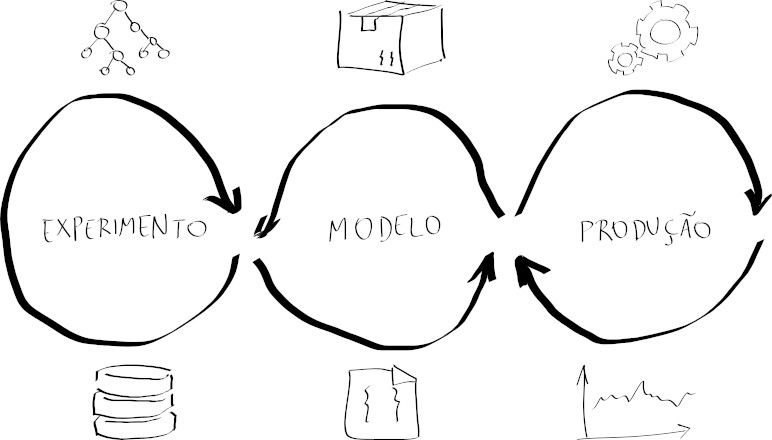
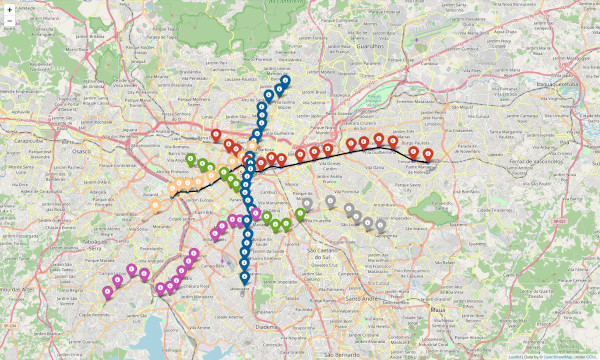
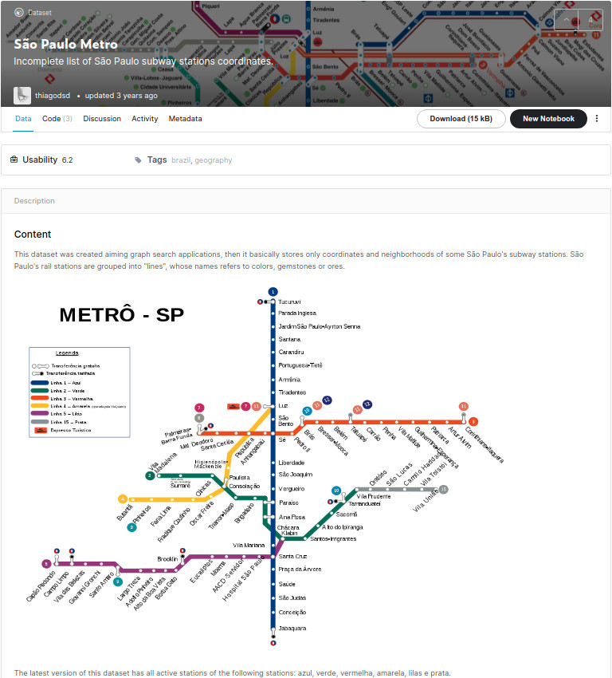
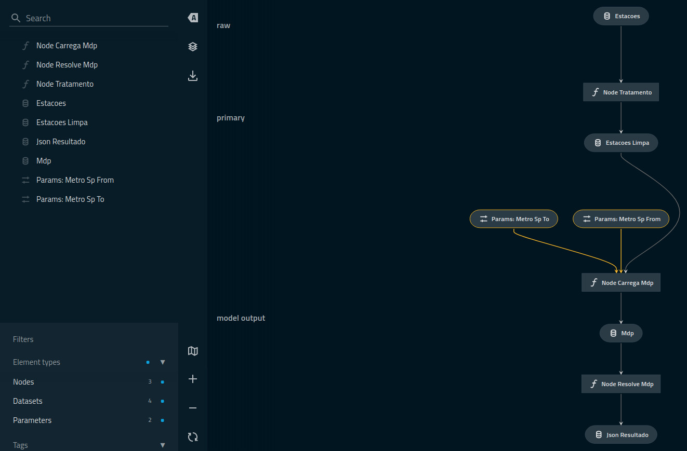
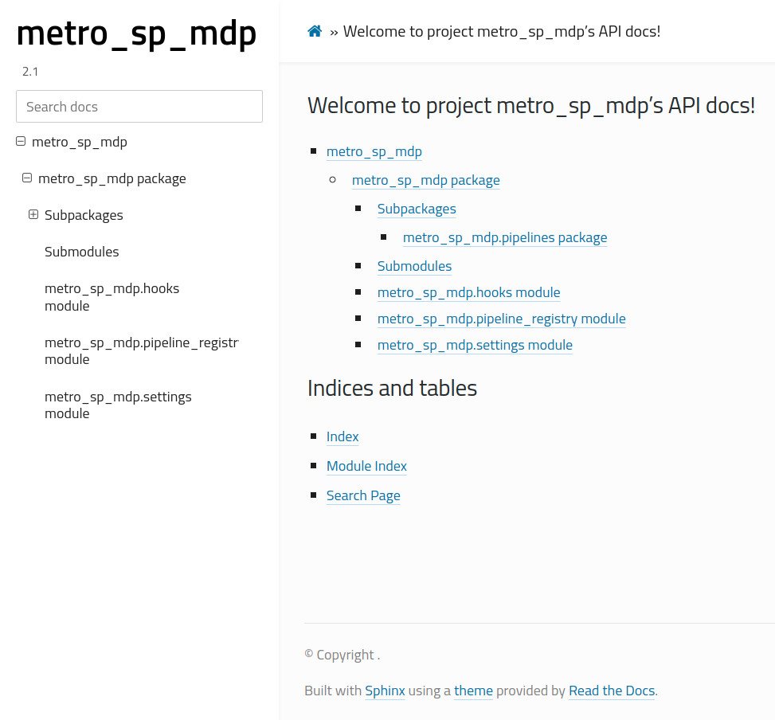

Inicialmente escrito como uma seção da página _[memória da máquina]_, entituluda "modelo como _interface de programação de aplicativos_", esse texto é composto por reflexões e comentários sobre a questão "o que fazer com um modelo treinado?"

## mlops

Por algum motivo -- ou por muitos -- praticamente todos os materiais de estudo contendo aprendizagem de máquina, aprendizagem estatística, inteligência artificial, redes neurais, ciência de dados, etc, no título, que eu estudei até hoje, não tratam de assuntos relacionados ao que fazer após a execução da última célula do _notebook_ de modelagem.

Em um contexto acadêmico, por exemplo, um projeto de aprendizagem de máquina é composto por um conjunto de experimentos guiados pelo método científico. Após as conclusões os resultados são sumarizados, publicados e eventualmente apresentados em congressos. Porém, no contexto de mercado, em que projetos de aprendizagem de máquina entregam soluções para tomada de decisões de negócios, há um universo além dos ciclos de experimentação e divulgação de resultados: é necessário homologar, documentar, versionar, empacotar, implantar e monitorar o produto do projeto.

Diagramas de metodologias como a [CRISP-DM] sugerem que todas essas etapas que sucedem a aplicação de técnicas de aprendizagem de máquina compõem um vértice isolado -- ou seja, um tipo de ponto final do projeto. Contudo, nem sempre esse é o caso: projetos são versionados e monitorados inclusive na expectativa da identificação de problemas a serem corrigidos e melhorias a serem incorporadas em versões futuras. Além disso, ao sintetizar tantas etapas em "_deployment_" o [diagrama][img_1] suprime o caráter interdisciplinar desse tipo de projeto -- manifestado principalmente na integração entre ideias de ciência da computação, aprendizagem estatística e práticas de desenvolvimento de software.

Desse caráter fortemente cíclico e dessa essência _dev_ de projetos de aprendizagem de máquina, [ideias como _MLOps_ vêm se popularizando][trends_ml_ops]. Apesar do conceito não estar completamente consolidado, _MLOps_ sugere a incorporação entre _machine learning_ (ML) e a já estabelecida cultura _[DevOps]_, que integra desenvolvimento de softwares (Dev) a operações em infraestrutura (Ops).

<!--
<div markdown="1">

</div>
-->

Na prática em _MLOps_ todas as etapas de um projeto de aprendizagem de máquina em contexto de mercado estão integradas em um fluxo cíclico. É fácil de encontrar bons diagramas ilustrando a dinâmica da _MLOps_, mas para os propósitos desse texto vou usar a seguinte releitura pessoal:

<div markdown="1">

</div>

Alguns elementos recorrentes desse tipo de diagrama estão omitidos ou renomeados -- de fato, é uma releitura. Apesar disso, os principais artefatos estão presentes. Após a formulação do problema a ser solucionado pelo produto final do projeto, seu desenvolvimento flui em torno de três eixos:

* **experimento**: O núcleo "ML" da sigla; basicamente composto do que a maioria dos livros-texto sobre ciência de dados trata: visualização de **dados**, extrações e engenharia de _features_ -- padronização, redução de dimensionalidade, inputação de valor, etc --, treino e validação de **algoritmos** de aprendizagem de máquina.<br/>
O comum em representações de _MLOps_ é que esse primeiro eixo seja "_design_" -- seguido de "_model deployment_" e "_operations_" --, indicando que é onde iterações de definição de escopo do projeto ocorrem. Prefiro "experimento" porque todo processo até a validação do modelo finalista é fundamentalmente exploratório e portanto experimental.<br/><br/>
* **modelo**: O núcleo "Dev", oculto na sigla; composto pelo **versionamento** e **empacotamento** do modelo, além da criação de fluxos de [CI/CD].<br/><br/>
* **produção**: O núcleo "Ops" da sigla; composto principalmente pela **implantação** do modelo para uso e seu subsequente **monitoramento**.

Vale comentar que há um viés "modelocêntrico" na descrição acima, de modo que os mesmos eixos poderiam ser redefinidos a partir de um ponto de vista centrado em dados.

## exemplo

Para materializar as ideias de _MLOps_, paradoxalmente vou substituir um modelo de aprendizagem de máquina por um algoritmo de busca em grafo. A grande vantagem dessa substituição é a simplificação dos testes de sanidade do resultado final. A adaptação da busca em árvore para a predição de modelos é trivial e será discutida brevemente na seção sobre a página _web_.<br/>
Embora a implementação do algoritmo de busca não seja explicada em detalhes nesse texto, o código pode ser melhor compreedindo através do _notebook_ Kaggle _[Simple Tree Search]_. 

Finalmente, o sistema considerado é o conjunto de (algumas) estações do [metrô da região metropolitana de São Paulo][wiki_metro_sp] e o problema resolvido é

> dadas duas estações, qual é o caminho ótimo entre elas?

No _notebook_ a ideia é que o resultado seja uma imagem do mapa contendo as estações e uma linha representando o caminho ótimo 

<div markdown="1">

</div>

Entretanto, para simplificar o exemplo desse texto, desconsiderei a construção desse gráfico final e usei apenas o resultado do algoritmo de busca.

### experimento

Nesse problema especificamente, os experimentos associados a **dados** se concentraram no desenvolvimento de _scripts_ para captura das informações relevantes -- estações, latitude, longitude e conexões a outras estações -- e transformação para estruturas que possibilitem a execução de algoritmos de busca em grafo. O produto final desse processo é a tabela `metrosp_stations.csv` do _dataset_ Kaggle [São Paulo Metro].

<div markdown="1">

</div>

Os experimentos relacionados a **algoritmos** aqui foram focados na escolha da melhor estratégia entre as [principais técnicas de busca][wiki_busca_arvore] para a representação do metrô de São Paulo em grafo. O algoritmo de busca escolhido é o _[depth-first search]_.

### modelo

Após a seleção de um algoritmo a partir dos resultados dos experimentos, o modelo é documentado, versionado e empacotado para uso produtivo. Uma forma de minimizar esforços nas tarefas de documentação e **empacotamento** é adaptar o modelo ao _framework_ da biblioteca [Kedro]. 
#### kedro

Como a própria documentação da biblioteca sugere, Kedro pode ser entendida como um _framework_ para projetos de ciência de dados. Na prática e a grosso modo, adotar esse _framework_ significa obedecer algumas regras de onde tabelas, parâmetros e funções devem estar para que a biblioteca lide com documentação, empacotamento e publicação do projeto, por exemplo.

O custo dessas facilidades é uma curva de aprendizagem que eu considero levemente íngrime e por isso esse texto vai tratar a biblioteca como uma ferramenta, se esquivando o máximo possível da pretenção de explicar como usá-la. Apesar disso, é útil comentar desde já que a unidade básica do Kedro são os _nodes_ e que _pipelines_ essencialmente são _nodes_ dispostos de forma sequencial.

##### _pipelines_ e _nodes_

Projetos kedro podem ser iniciados com 

```sh
kedro new        # cria o projeto
kedro build-reqs # cria src/requirements.in
kedro install    # instala as bibliotecas
```

e pipelines são construídos com

```sh
kedro pipeline create nome_do_pipeline
```

O comando `kedro new` constrói a estrutura de diretórios do projeto, representada abaixo -- com a supressão de alguns que não serão relevantes nesse texto

```
.
├── conf
│   ├── base
│   │   ├── catalog.yml      <--- aqui os dados de entrada e saída são identificados
│   │   ...
│   │   └── parameters.yml   <--- aqui ficam os parâmetros
│   ...
├── data   <--- aqui ficam os dados
│   ...
├── docs   <--- aqui fica a documentação
│   ...
...
└── src
    ├── nome_do_projeto
    │   ...
    │   ├── pipeline_registry.py   <--- aqui os pipelines são declarados
    │   ├── pipelines
    │   │   ├── __init__.py
    │   │   └── nome_do_pipeline
    │   │       ├── __init__.py
    │   │       ├── nodes.py       <--- aqui as funções são definidas
    │   │       ├── pipeline.py    <--- aqui as funções são associadas
    │   │       ...
    │   ...
    ├── requirements.in   <--- aqui vão as bibliotecas
    ...
```

<br/>

A adaptação de um _notebook_ Kaggle  para a estrutura de projetos Kedro pode ser feita **(1)** transferindo os dados para algum sub-diretório de `data` **(2)** os registrando em `conf/base/catalog.yml` de acordo com seus tipos

```yml
tabela_1:
  type: pandas.CSVDataSet
  filepath: data/01_raw/dataset_a.csv

tabela_2:
  type: pandas.CSVDataSet
  filepath: data/01_raw/dataset_b.csv

resultado:
  type: json.JSONDataSet
  filepath: data/07_model_output/resultado.json
```

**(3)** se necessário adicionando os parâmetros em `conf/base/parameters.yml`

```yml
param_1: "palavra"

param_2: 
    - 0.001
    - 0.01
    - 0.1
    - 1.0
```

**(4)** escrevendo as funções no arquivo `src/nome_do_projeto/pipelines/nome_do_pipeline/nodes.py`

```py
def funcao_1(t:pd.DataFrame, s:str) -> float:
    ...
    return val


def funcao_2(t:pd.DataFrame, l:List, v:float) -> Dict:
    ...
    return dic
```

**(5)** replicando a lógica do _notebook_ no arquivo `src/nome_do_projeto/pipelines/nome_do_pipeline/pipeline.py`, em forma de _nodes_ agrupados em _pipelines_

```py
def create_pipeline(**kwargs) -> Pipeline:
    pipeline_1 = Pipeline(
        [
            node(
                funcao_1,
                inputs = ["tabela_1", "params:param_1"],
                outputs = "valor_intermediario",
                name = "node_1",
            ),
            node(
                funcao_2,
                inputs = ["tabela_2", "params:param_2", "valor_intermediario"],
                outputs = "resultado",
                name = "node_2",
            )
        ]
    )

    return pipeline_1

```

e **(6)** declarando os _pipelines_ no arquivo `src/nome_do_projeto/pipeline_registry.py`

```py
from nome_do_projeto.pipelines import nome_do_pipeline

def register_pipelines() -> Dict[str, Pipeline]:
    pipeline_1 = nome_do_pipeline.create_pipeline()

    return {
        "pipeline_1" : pipeline_1,
        "__default__": pipeline_1
        }
``` 

#### git

O raciocínio descrito nesses seis passos foi usado na adaptação do _notebook_ _[Simple Tree Search]_. O **versionamento** do projeto foi feito no repositório [`metro-sp-mdp`](https://github.com/thiagodsd/metro-sp-mdp) -- a partir daqui é relevante saber que a versão do projeto pode ser controlada através do parâmetro `version` da função `setup` do arquivo `src/setup.py`; o valor desse parâmetro é incorporado no _layout_ da documentação e no nome do arquivo do pacote.  

A estrutura do projeto pode ser visualizada com

```sh
kedro viz
```

<div markdown="1">

</div>

A **documentação** pode ser construída em `docs/build/` com

```sh
kedro build-docs
```

<div markdown="1">

</div>

```sh
kedro package
```

`src/dist/`

#### pypi

`~/.pypirc`

```
[pypi]
  username = __token__
  password = API_TOKEN   # criada em https://pypi.org/manage/account/
```

`src` 

```sh
python3 -m twine upload dist/* --verbose
```

### produção

#### flask

```py
import metro_sp_mdp.pipelines.mdp as sp_mdp
...

app = Flask(__name__, template_folder='templates')

@app.route('/', methods=['GET', 'POST'])
def form_input():
    if request.method == 'GET':
        return render_template('index.html')
    
    if request.method == 'POST':
        metro_from = request.form['metro_from'].lower()
        metro_to = request.form['metro_to'].lower()
        ...
        return render_template('index.html', result=solucao['estacoes'])

if __name__ == '__main__':
    app.run(host='0.0.0.0', port=80)
```

<br/>

```html

<form class="" action="{{ url_for('form_input') }}" method="POST">
    <label for="metro_from">da estação </label> <input type="text" name="metro_from" id='metro_from'> 
    <label for="metro_to">para a estação </label> <input type="text" name="metro_to" id='metro_to'> 
    <button type="submit" name="button">resolver</button>
</form>
<br/>
<div class="resultado">
    
        
            {{ value }} - 
        
    
</div>

```

#### ec2

```sh
 chmod 400 security_key.pem 
 ssh -i security_key.pem ec2-user@public_ipv4_address
```

#### docker

```sh
kedro docker init
kedro docker build
```

<br/>

```
!data/01_raw/metrosp_stations.csv
```

<br/>


```dockerfile
ARG BASE_IMAGE=python:3.8-slim
FROM $BASE_IMAGE

RUN pip install --upgrade pip
RUN pip install metro-sp-mdp --upgrade

WORKDIR /app
ADD . /app

EXPOSE 80
ENTRYPOINT ["python3", "app.py"]
```

<br/>


```sh
clone -b release/2.0.0 https://github.com/thiagodsd/metro-sp-mdp.git
cd metro-sp-mdp/
sudo service docker start
sudo docker build -t metrosp .
sudo docker run -p 80:80 metrosp .
```

[memória da máquina]: /2020/01/05/memoria-da-maquina.html
[CRISP-DM]: https://pt.wikipedia.org/wiki/Cross_Industry_Standard_Process_for_Data_Mining
[CI/CD]: https://pt.wikipedia.org/wiki/CI/CD
[DevOps]: https://pt.wikipedia.org/wiki/DevOps

[Simple Tree Search]: https://www.kaggle.com/thiagodsd/simple-tree-search
[São Paulo Metro]: https://www.kaggle.com/thiagodsd/sao-paulo-metro
[Kedro]: https://kedro.readthedocs.io/en/stable/
[EC2]: https://aws.amazon.com/pt/ec2/
[PyPI]: https://pypi.org/

[depth-first search]: https://pt.wikipedia.org/wiki/Busca_em_profundidade

[img_1]: https://en.wikipedia.org/wiki/Cross-industry_standard_process_for_data_mining#/media/File:CRISP-DM_Process_Diagram.png

[ref_1]: https://blog.cambridgespark.com/deploying-a-machine-learning-model-to-the-web-725688b851c7
[ref_2]: https://medium.com/analytics-vidhya/how-to-deploy-your-machine-learning-model-in-the-cloud-87d3451a466d
[ref_3]: https://medium.datadriveninvestor.com/dockerizing-and-hosting-your-flask-web-app-rest-api-on-aws-ec2-9f9c189bf563

[metro_z_library]: https://pt.wikipedia.org/wiki/Z-Library
[wiki_metro_sp]: https://pt.wikipedia.org/wiki/Metr%C3%B4_de_S%C3%A3o_Paulo
[wiki_busca_arvore]: https://pt.wikipedia.org/wiki/Categoria:Algoritmos_de_busca

[trends_ml_ops]: https://trends.google.com/trends/explore?date=today%205-y&q=%2Fg%2F11h1vbjpbg